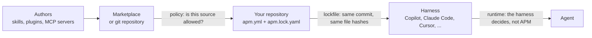

This page is for anyone deciding how a team or an organization should manage what its coding
agents load. It explains why that question turns into a dependency problem, which controls
help, and what they cannot do. No background in supply-chain security is assumed.

**The short answer.** What a coding agent loads decides what it knows and what it can do. Once
teams write and share those files, they become dependencies, and dependencies need what code
dependencies already have: an owner, a version, a declaration and a lock.

## What an agent loads

A coding agent runs inside a harness: the tool you work in, such as GitHub Copilot, Claude
Code, Cursor or Codex. Before the agent acts, the harness reads files from your repository and
your home folder:

- **Skills**: folders with a `SKILL.md` that teach a task, such as reviewing a pull request.
- **Instructions**: your conventions, loaded on every request or for matching files.
- **Prompts and commands**: tasks you start by name, such as `/review`.
- **Agents**: specialized roles with their own instructions and tools.
- **Hooks**: scripts the harness runs on events, such as before a tool call.
- **MCP servers**: programs that give the agent tools, such as a database or an issue tracker.
- **Plugins**: bundles of the above, installed as one unit.

Together these are the agent's capabilities. Change a skill, and every agent that loads it
behaves differently on the next run. Add an MCP server, and every agent that loads it can do
something new.

## From one repository to shared dependencies

Picture a team with a reviewer who knows what to look for. They write that judgment into a
review skill, and it works. Other teams want it, so they copy it into their repositories.

Copying works on day one. Then the original improves, teams edit their copies, and nobody can
say who has what. Six months later, which version does `payments-api` follow? Fixes do not
reach the copies, improvements in the copies do not flow back, and no one can list which agent
files are in use across the organization.

Code had the same problem before package managers. The answer carries over: treat the skill like
any other dependency, with an owner, a version, a declaration and a lock. The agent supply chain
is the path those capabilities take, from the people who write them to the agents that load
them.

Each arrow is a hand-off where something can go wrong. APM adds checks on the first two; the
last one belongs to your harness.

## The path teams walk

Most teams move through three stages:

1. **Use the harness as shipped.** The agent comes with its own features. There is little to
   manage.
2. **Customize.** Teams write and share their own skills, agents and instructions, often
   starting from a public set. This is where copying starts and drift begins.
3. **Run an agentic software lifecycle.** Agents do real delivery work in loops: plan, change
   code, review, fix the build. People spend less attention per change, so the capabilities
   agents load shape more of what ships. They need a governed supply: known sources, known
   versions, checked on every change.

At stages two and three, organizations tend to centralize. A platform, developer-experience or
security team publishes approved capabilities in a marketplace: a published list of plugins
and packages that repositories browse and install from. An organization's private marketplace
is how it builds a curated catalog of agent capabilities. Many repositories install from it, an
org policy says which sources are allowed, and CI checks every pull request.
[Build your organization's marketplace](../../enterprise/org-marketplace/) walks through it.

## Five controls code already has

Code supply chains rely on five controls. Each has an agent equivalent:

| Control | For code | For agent capabilities | In APM |
|---|---|---|---|
| Manifest | `package.json`, `Cargo.toml` | Which skills, plugins and MCP servers a repository uses, at which versions | `apm.yml` |
| Lockfile | `package-lock.json`, `Cargo.lock` | The exact commit of each package and a hash of every file written | `apm.lock.yaml` |
| Integrity check | `npm ci` checks package hashes | Files on disk match the lockfile | `apm install --frozen`, `apm audit` |
| Policy | Allowed registries and licenses | Allowed sources, required packages, whether hooks and MCP servers may deploy | `apm-policy.yml` |
| Audit | Vulnerability reports, SBOMs | Drift reports, a hidden-Unicode scan, an inventory in CycloneDX or SPDX | `apm audit`, `apm lock export` |

Hidden Unicode deserves a word. Characters that render as nothing can carry instructions an
agent reads and a human reviewer does not see. APM scans for them at install and in
`apm audit`.

## Where these controls stop

The controls above are useful and limited. Know the limits before you rely on them:

- **APM governs what gets installed; the harness governs what runs.** Once a hook or MCP server
  is installed, it runs with the agent's permissions, under the harness's rules. Policy is not
  a sandbox.
- **A lockfile records what arrived, not that it can be trusted.** It locks in whatever you
  installed the day you added it. Review a new dependency, or a version bump, the way you
  review code.
- **Provenance is recorded, not cryptographically attested.** APM records which package and
  commit each file came from. It verifies no signatures, and its inventory is not an
  attestation.
- **The scan looks for hidden characters, not intent.** APM does not judge whether a skill is
  malicious.
- **Defaults are permissive.** An org policy warns until the organization sets it to block,
  and hooks from your dependencies deploy until a project or org policy restricts executables.
  Tightening is a decision you make; [Agent supply chain security model](../../enterprise/security/) lists the
  settings.

## Public signals

This is a young field, and the evidence is still arriving. Three public sources describe it:

- The [Thoughtworks Technology Radar, Vol. 35](https://www.thoughtworks.com/radar/tools/summary/agent-package-manager)
  (November 2026) places Agent Package Manager in Trial and says it "treats agent context as a
  supply chain".
- Snyk's [ToxicSkills research](https://snyk.io/blog/toxicskills-malicious-ai-agent-skills-clawhub/)
  (February 2026) scanned 3,984 skills from ClawHub and skills.sh and found at least one
  critical issue in 13.4% of them. Public sources mix excellent and harmful content; knowing
  exactly what you installed, and from where, is the starting point.
- The Agent Plugins 1.0 specification standardizes the plugin format and lists dependency
  resolution, provenance verification and enterprise controls under
  [future considerations](https://github.com/agentplugins/agent-plugins-spec/blob/main/FUTURE_CONSIDERATIONS.md).
  The format moves capabilities between harnesses; managing them is left to other tools.

## Where to go next

- Lock one repository's agent setup in five minutes:
  [Give every teammate the same skills, plugins and MCP servers](../../quickstart/).
- Publish approved capabilities for your organization:
  [Build your organization's marketplace](../../enterprise/org-marketplace/).
- See every control, its default and how to tighten it:
  [Agent supply chain security model](../../enterprise/security/).
