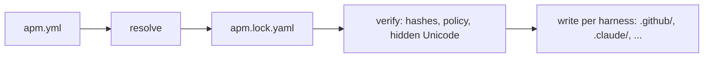

This page is for anyone who has run `apm install` once and wants to know what happened. It
explains the seven ideas behind every APM command.

In short: you declare what your coding agents should load in `apm.yml`. APM resolves it,
records the exact result in `apm.lock.yaml`, and writes files in the format each agent tool
reads.

If you know Rust, this is `Cargo.toml` and `Cargo.lock`. The manifest is your intent, the
lockfile is the record of what you got, and the files APM writes are build output you can
regenerate at any time.

## Seven ideas

### 1. Package

A package is a git repository, or a folder in one, that APM can install. It may carry its own
`apm.yml`, or no more than a `SKILL.md`, a `skills/` folder or a `plugin.json`. You refer to it as
`owner/repo#v1.1.0`, as a local path, or as `name@marketplace`. There is no account and no
central registry: packages come from git hosts such as GitHub, GitHub Enterprise, Azure DevOps
and GitLab, or from your disk. [Package types](../../reference/package-types/) lists every layout APM recognizes.

### 2. What agents load

A package carries the files that shape what an agent knows and can do: skills (`SKILL.md`
folders), instructions, prompts, agents, hooks, commands, MCP servers, LSP servers and plugins.
APM calls each of these a primitive. Authors write them under `.apm/` in the package;
[Write skills, instructions and hooks](../../producer/write-primitives/) shows how.

### 3. Manifest

`apm.yml` sits at the root of your repository and says what you want:

```yaml title="apm.yml"
name: payments-api
version: 1.0.0
targets: [copilot, claude]
dependencies:
  apm:
    - contoso/review-skills#v1.1.0
  mcp:
    - io.github.github/github-mcp-server
```

You edit it by hand or let `apm install <package>` add a line.
[Manifest schema](../../reference/manifest-schema/).

### 4. Lockfile

`apm.lock.yaml` records what APM installed: for each package, the commit it resolved
to (pinned), and a SHA-256 hash for every file it wrote (locked). Transitive dependencies, the
packages your packages depend on, are recorded too. Commit it next to `apm.yml`.

A lockfile records what arrived when you installed it, not that the content can be trusted.
Reviewing a package before you add it is still your job.
[Lockfile specification](../../reference/lockfile-spec/).

### 5. Harness and target

A harness is the agent tool that reads the files: GitHub Copilot, Claude Code, Cursor, Codex,
Gemini CLI, OpenCode, Windsurf, Kiro and others. Each reads its own folder, such as `.github/`
for Copilot and `.claude/` for Claude Code; several share `.agents/skills/`. The `targets:`
field names the harnesses APM writes for. Without it, APM looks for harness folders, and stops
with `No harness detected` if it finds none. `apm targets` shows the result.
[Choose your harnesses](../../consumer/choose-harnesses/).

### 6. Install and frozen install

`apm install` reads `apm.yml`, reuses the lockfile's pins for entries that did not change,
resolves anything new, writes the files and updates the lockfile. `apm install --frozen`
installs exactly what the lockfile records and never rewrites it; it fails when `apm.yml` and
the lockfile disagree. A teammate's fresh clone and your CI use `--frozen`. Moving a pin
forward is a separate, deliberate step: `apm update`.

`apm install` deploys individual primitives but does not run aggregate
compilation. Run `apm compile` explicitly to generate root or distributed
context files such as `AGENTS.md`, `CLAUDE.md`, and `GEMINI.md`. `apm run`
still compiles any `.prompt.md` files referenced by a script immediately
before execution.

### 7. Policy

An organization can publish `apm-policy.yml` in its `.github` (or `.github-private`)
repository to say which sources
are allowed, which packages are required, and whether hooks and MCP servers may deploy. APM
finds it from your repository's git remote and checks it during `apm install` and
`apm audit --ci`. Out of the box a violation is a warning; the organization decides when it
blocks. [Set an org policy](../../enterprise/apm-policy/).

## From manifest to files



`resolve` turns each line of `apm.yml` into a commit and downloads it into `apm_modules/`.
`verify` checks the downloaded content against the hashes in the lockfile, checks the policy,
and scans for hidden Unicode characters that can carry instructions a reviewer cannot see.
`write` produces each harness's own format, so a prompt can become a Copilot prompt file and a
Claude Code command. A plain install updates the lockfile from `apm.yml`; a frozen install
starts from the lockfile and leaves it untouched.

## Two planes: install and runtime

APM works on the install plane: which sources are allowed, which exact bytes arrive, and where
they land. Your harness works on the runtime plane: when to load a skill, which tools the agent
may call, what needs your approval, and how commands are isolated. APM does not run
your agent and does not limit what it does at runtime. `apm-policy.yml` governs what gets
installed; your harness governs what runs.

## Deployed files are build output

Treat `.github/agents/`, `.claude/skills/` and the other folders APM writes the way you treat
compiled output. Change a package at its source, in the package's repository or your own
`.apm/` folder, then install again. If you edit a deployed file, APM keeps your edit and warns,
`apm audit` reports drift, and `apm install --frozen` fails. `apm export-patch` turns the edit
into a patch for the package's author; `apm install --force` puts the locked version back.

## Common questions

**Should I commit the files APM writes?**
Always commit `apm.yml` and `apm.lock.yaml`, never `apm_modules/`. Deployed files are
optional: a clone rebuilds them with `apm install --frozen`. Commit them when something reads
the repository without running APM, such as a cloud coding agent. Commit native plugins
(`.agents/plugins/`, `.claude/settings.json`, `.github/copilot/settings.json`) as well: harnesses
load them from the repository. [Run in CI](../../consumer/run-in-ci/).

**Where did this file come from?**
`apm find .claude/skills/style-checker/SKILL.md` prints the package that wrote it; add `--source`
for the ref. `apm deps why <package>` shows which dependency pulled it in.
[Inventory and drift](../../enterprise/drift-detection/).

**Does APM run my agent?**
No. APM installs files and exits. Your harness loads them and decides what the agent may do.
[The agent supply chain](../agent-supply-chain/).

**Do I need an account or a registry?**
No. Packages come from git repositories and local folders; private repositories use the git
credentials you already have. [Use private sources](../../getting-started/authentication/).

**What is `apm_modules/`?**
The project's download folder: one directory per installed package, at its locked commit. APM
adds it to `.gitignore` and rebuilds it on install; `apm prune` removes packages you no longer
depend on. [Add and remove packages](../../consumer/install-packages/).

**Which harnesses are supported?**
GitHub Copilot, Claude Code, Cursor, Codex, Gemini CLI, OpenCode, Windsurf, Kiro and more, each
with its own set of primitives. [Targets matrix](../../reference/targets-matrix/).

**Will APM overwrite files I wrote by hand?**
No. APM skips a file it did not write and tells you; `--force` overwrites it. Hand-written and
APM-managed files live side by side. [Coming from another tool](../../getting-started/coming-from/).
