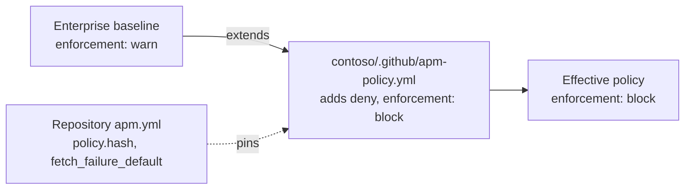

import { Steps } from '@astrojs/starlight/components';

You own what coding agents may load across your organization. This page gets you from
no policy to a blocking one: one file, `apm-policy.yml`, that APM finds from each
repository's git remote and applies at `apm install` and in `apm audit --ci`.

A policy restricts where packages may come from, which MCP servers and transports are
allowed, and which harnesses (agent tools such as Claude Code or GitHub Copilot) may be
targeted. It governs what gets installed, not what
an agent does at runtime. Every field is in the [policy schema](../../reference/policy-schema/).

## Write and roll out the policy

Priya, on the Contoso platform team, starts in `warn` so nothing breaks on day one.

<Steps>

1. **Write the policy** in your org policy repository. Start with one allow rule and one
   deny rule:

   ```yaml title="contoso/.github/apm-policy.yml"
   name: contoso-agent-policy
   version: "1.0.0"
   enforcement: warn
   dependencies:
     allow:
       - "github.com/contoso/**"
       - "github.com/microsoft/**"
     deny:
       - "github.com/untrusted-org/**"
   ```

   `*` matches one path segment, `**` any depth. A host-qualified pattern such as
   `github.com/contoso/**` matches that host and no other, which closes the gap where a
   same-named repository on another host would also match. `deny` always wins over
   `allow`, and both apply to transitive dependencies too.

2. **Test the draft** from a member repository before you commit it:

   ```bash frame="terminal"
   apm policy status --policy-source ./apm-policy.yml --check --json
   ```

   ```text frame="none"
   {
     ...
     "enforcement": "warn",
     "outcome": "found",
     "rule_summary": [
       "1 dependency denies",
       "2 dependency allow patterns"
     ],
     "source": "file:apm-policy.yml",
     ...
   }
   ```

   `--check` exits 1 when no usable policy resolves, so the same command works as a CI
   pre-check.

3. **Preview what it would flag** in that repository:

   ```bash frame="terminal"
   apm audit --ci --policy ./apm-policy.yml
   ```

   ```text frame="none"
   ...
   | [!]      | dependency-allowlist     | 1 dependency(ies) not in allow list (enforcement: warn)    |
   ...
   11 check(s) passed; 1 report violations under 'enforcement: warn' and fail once the policy switches to block.
   ```

   Under `warn`, a violation is reported and the command still exits 0. Here a transitive
   dependency from `github.com/github/...` is outside the allow list. Decide now whether
   to allow it or ask the team to drop it.

4. **Commit the policy** to `contoso/.github` and protect it: CODEOWNERS for your team,
   branch protection, required review. That repository is now your trust root.

5. **Confirm discovery** from any member repository:

   ```bash frame="terminal"
   apm policy status --check
   ```

   `Outcome` must read `found` and `Source` must name your organization's policy repository. Anything else
   means discovery failed; see [Debug a policy failure](#debug-a-policy-failure).

6. **Move to block** once the warnings are triaged:

   ```diff title="contoso/.github/apm-policy.yml"
   -enforcement: warn
   +enforcement: block
   +fetch_failure: block
   ```

   Now `apm install` exits 1 before deploying any file, and `apm audit --ci` fails the
   pull request. `fetch_failure: block` makes a failed refresh of a cached policy fail
   instead of proceeding. A machine with no cached copy cannot read that setting, so
   also set `policy.fetch_failure_default: block` in each repository's `apm.yml`, and
   run `apm policy status --check` in CI ([Gate pull requests](../enforce-in-ci/)).

</Steps>

## Where it lives

APM derives the organization from the checkout's git remote and looks for
`apm-policy.yml` in these repositories, in this order. The earliest match wins.

| Host | Discovery order |
|---|---|
| GitHub, GitHub Enterprise Server, GHE.com | 1. `<org>/.github-private` 2. `<org>/.github` 3. `<org>/.apm` 4. `<org>/_apm` |
| Azure DevOps | 1. Repository `apm-policy` in project `apm` 2. Legacy `_apm/_apm`, tried after a 404 from the primary location, with a migration warning |
| GitLab (gitlab.com and self-managed) | An `apm-policy` project in the top-level group and in every subgroup down to the project; all found policies combine, top-level group outward. `APM_GITLAB_POLICY_REPO` renames the project |

Prefer `.github-private`: policy rules are internal. APM recognizes self-managed
GitLab when `GITLAB_HOST` or `APM_GITLAB_HOSTS` names it. GitLab answers 404 for a private
project the token cannot read, so give the CI token read access to every `apm-policy`
project in the group path. For other hosts, pass the source explicitly:
`apm audit --ci --policy <path-or-url>`.

## Inherit policies without loosening them

A policy can `extends:` a parent, such as an enterprise baseline that several
organizations share. A child can tighten, never loosen: allow lists intersect, deny lists
union, `enforcement` and `fetch_failure` take the stricter value. Cross-host `extends:`
is rejected, and an unreachable parent fails closed.



A repository cannot loosen the org policy. Its `apm.yml` can pin the policy bytes
(`policy.hash`) and choose to fail closed (`policy.fetch_failure_default: block`);
nothing more. Merge
rules per field: [policy schema](../../reference/policy-schema/#merge-rules).

## Local bypasses, and why CI is the gate

A developer can skip policy on their machine: `apm install --no-policy` for one command,
or `APM_POLICY_DISABLE=1 apm <command>` (never export it in CI). A fork under a personal account
discovers the fork owner's policy, not yours. User-scope installs (`apm install -g`)
have no git remote and are not governed. None of this changes the pull request: a
required `apm audit --ci --policy org` check re-runs the policy in CI, where the
bypass is not set. See [Gate pull requests](../enforce-in-ci/).

## Debug a policy failure

A blocked `apm install` prints one `[x] Policy violation: <dependency> -- <reason>`
line per finding, then `Blocked by org policy at <source> (<check>)`. `apm audit --ci`
shows the same check as an `[x]` row followed by its details. Then:

1. **Which policy ruled?** Run `apm policy status`. `Outcome`, `Source`, `Enforcement`
   and `Extends chain` answer it. Add `--no-cache` if an admin changed the policy in the
   last hour (the default cache TTL is 3600 seconds).
2. **Wrong policy or none?** Check `git remote get-url origin`: discovery follows the
   remote's owner. Test another source with `--policy-source <owner>/.github`.
3. **Why is a hook or MCP server parked?** `apm policy explain <pkg>` shows the
   executable-trust decision and which layer made it.
4. **Fix the right side.** Change the dependency in `apm.yml`, or open a pull request
   against the policy repository with the rationale. The policy history is your
   exception log.

## Related

- [Policy schema](../../reference/policy-schema/): every field and default.
- [`apm policy`](../../reference/cli/policy/): `status` and `explain` options.
- [Control executables](../control-executables/): the `executables:` section of the policy.
