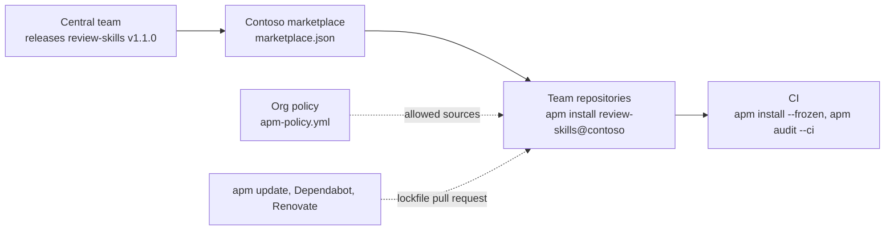

import { Steps, Aside, Badge } from '@astrojs/starlight/components';

This page is for the central team that curates agent capabilities for an organization.
Your job: publish the skills, agents, instructions, hooks, MCP servers and plugins your
organization approves, as versioned packages that every repository installs by name,
and keep control of when updates land.

## Why a private marketplace

An expert writes a good review skill. Teams copy it into their repositories. The source
improves, the copies do not, and six months later nobody can say which version the
payments service follows. The fix is the one code dependencies already use: give the
skill an owner, a version, a declaration and a lock.

Organizations that run this today follow one pattern. A central team publishes versioned
packages through its own marketplace. Repositories install them with version ranges. An
org policy restricts sources to the repositories the marketplace points to. A CI check replays every
lockfile, and updates arrive as lockfile diffs in pull requests.

A **marketplace** is a published list of packages that people browse and install by
name. In APM it is a git repository holding a `marketplace.json` file, which `apm pack`
generates from a `marketplace:` block in `apm.yml`. Claude Code reads the same file;
optional outputs serve GitHub Copilot CLI and Codex. The marketplace lists packages; the
packages themselves stay in their own repositories, each with its own tags.



## Walk through it

The Contoso cast: Ben maintains `contoso/review-skills` and the marketplace repository
`contoso/agent-marketplace`; Priya owns the org policy; Ana works in a product
repository.

<Steps>

1. **List the package** (Ben). In `contoso/agent-marketplace`, describe each package
   and the versions to offer, then build the marketplace file:

   ```yaml title="apm.yml"
   name: contoso-agent-marketplace
   version: 1.0.0
   marketplace:
     owner:
       name: Contoso
     packages:
       - name: review-skills
         description: Code review skills approved by the platform team
         source: contoso/review-skills
         version: "^1.0.0"
   ```

   ```bash frame="terminal"
   apm pack
   ```

   `apm pack` resolves each range to the highest matching tag and writes
   `.claude-plugin/marketplace.json`. Each entry records both the tag and its commit.
   For a real public package it looks like this:

   ```json title=".claude-plugin/marketplace.json"
   "source": {
     "source": "github",
     "repo": "microsoft/apm-sample-package",
     "ref": "v1.0.0",
     "sha": "fb2851683be0e0e7711421d518bd8dba23b0b1f6",
     "tag_pattern": "v{version}"
   }
   ```

   `apm marketplace check` confirms every entry resolves; run it in CI before packing.
   Commit `apm.yml`
   and the generated file, and tag the marketplace repository.

2. **Restrict sources** (Priya). Policy rules match the repository each marketplace
   entry resolves to, not the marketplace name, and they apply to transitive
   dependencies too:

   ```yaml title="contoso/.github/apm-policy.yml"
   enforcement: block
   dependencies:
     allow:
       - "github.com/contoso/**"
   ```

   See [Set an org policy](../apm-policy/).

3. **Register the marketplace** (Ana). Registration is per machine and tells APM where
   the name `contoso` points:

   ```bash frame="terminal"
   apm marketplace add contoso/agent-marketplace --name contoso --ref v1.0.0
   ```

   To register it on every machine without a manual step, list it under `marketplaces:`
   in the user manifest (`~/.apm/apm.yml`) and run `apm install -g`, for example from
   your dev container setup. A project `apm.yml` cannot declare marketplaces.

4. **Declare the package with a range** (Ana), then install:

   ```diff title="apm.yml"
    dependencies:
      apm:
   +    - name: review-skills
   +      marketplace: contoso
   +      version: "^1.0.0"
   ```

   ```bash frame="terminal"
   apm install
   ```

   The lockfile records the commit and where it came from. From a run with
   `microsoft/apm-sample-package` listed in a marketplace named `contoso`:

   ```yaml title="apm.lock.yaml"
   - repo_url: microsoft/apm-sample-package
     resolved_commit: fb2851683be0e0e7711421d518bd8dba23b0b1f6
     resolved_ref: v1.0.0
     ...
     discovered_via: contoso
     marketplace_plugin_name: apm-sample-package
     constraint: ^1.0.0
     resolved_tag: v1.0.0
   ```

5. **Replay in CI.** The required check runs:

   ```bash frame="terminal"
   apm install --frozen
   ```

   Each locked entry reinstalls its locked commit and is checked against its hashes.
   <Badge text="New in 0.37" variant="note" /> Locked entries replay without reading the
   marketplace at all, so an edit to the marketplace cannot change what CI installs.
   Wire the full check with [Gate pull requests](../enforce-in-ci/).

6. **Ship an update** (Ben). Ben tags `v1.1.0` in `contoso/review-skills`
   ([Release a version](../../producer/release-a-version/)), then repacks so new
   installs default to it:

   ```bash frame="terminal"
   apm pack
   ```

7. **Take the update on purpose** (Ana). Nothing changes until someone asks:

   ```bash frame="terminal"
   apm update
   ```

   `apm update` resolves `^1.0.0` against the package's tags, picks `v1.1.0`, and
   rewrites `apm.lock.yaml`. The pull request shows the new commit and hashes; review it
   like any dependency bump.

</Steps>

Authoring uses the `marketplace:` block, `apm marketplace init`, `check`, `package`,
`outdated`, `audit` and `migrate`, and the marketplace output of `apm pack`. Full
authoring guide:
[Publish to a marketplace](../../producer/publish-to-a-marketplace/).

## How the marketplace is served

- **A git repository** on GitHub, GitHub Enterprise, GitLab, Azure DevOps or another git
  server, over HTTPS or SSH. Private marketplaces use the same credentials as private
  packages ([Use private sources](../../getting-started/authentication/)). Pin the
  marketplace with `--ref` so a moving default branch does not change what is listed.
- **A `marketplace.json` URL** over HTTPS. APM sends no credentials to it, so reserve
  this for public lists.
- **One marketplace per audience.** Keep several `marketplace.json` files in one
  repository and register each with `--path`. This organizes discovery; it is not
  access control. Use separate repositories when audiences need separate access.

<Badge text="New in 0.37" variant="note" /> The lockfile records each git marketplace's
origin. If someone later points the name `contoso` at a different repository,
`apm update` fails and names both origins instead of switching silently.

## Other hosting options

Neither is required; a git repository is enough.

- **JFrog Artifactory** offers
  [Agent Packages repositories](https://docs.jfrog.com/artifactory/docs/agent-packages-repositories)
  that work with the APM CLI to publish and install packages. APM talks to them
  through its registry support, which is Experimental
  (`apm experimental enable registries`).
- **Your own server** can implement the
  [Registry HTTP API](../../reference/registry-http-api/) (Experimental).

<Aside type="note" title="Planned">
Private marketplaces backed by the APM Registry HTTP API, with authoring and publishing
from CI and the same lock-and-replay consumption, are tracked in
[#3297](https://github.com/microsoft/apm/issues/3297). They are not available today.
</Aside>

## Related

- [Install from a marketplace](../../consumer/installing-from-marketplaces/): the developer side.
- [Publish to a marketplace](../../producer/publish-to-a-marketplace/): every authoring option.
- [`apm marketplace`](../../reference/cli/marketplace/): all subcommands.
