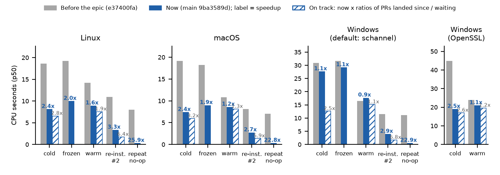
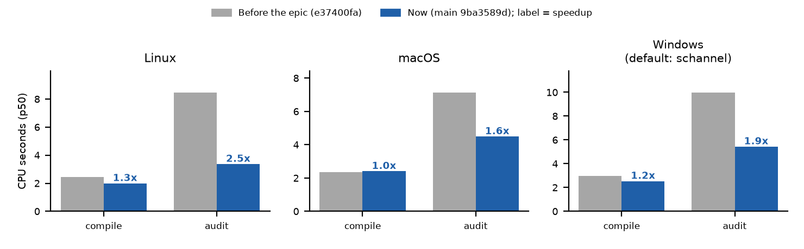

# APM performance since the epic

*PERF org report for the CEO, v1 2026-11-24 21:21 CET (data: Journey Hunt report.json; v2-harness rows final, v1 rows provisional). Final refresh after Wednesday's final bench pass.*

**Two baselines, both paired.** (a) **Before the epic** = main `e37400fa` (v0.38.0) vs main `9ba3589d`: Journey Hunt bench (6 pairs per cell). (b) **Validated interim** = main `703acd6f` (Nov 23 evening, already after the locked engine #4893) vs main `c0296fab`, 15 pairs, install only, **Windows on the OpenSSL TLS backend**. All charts use (a); (b) appears only in the gap paragraph and the table (*i*).

**How to read.** CPU seconds incl. child processes, p50 of interleaved before/now pairs on the same CI runner (3 runners per OS, modeled RTT 30 ms). **Speedup = 1 / paired p50 ratio; the ratio is the claim.** Seconds vary up to 2x by runner CPU class (reference AMD EPYC 9V74), so compare ratios. tree-10 / tree-50 = a project with 10 / 50 dependencies. Populations: *anonymous* = public github.com without a token; *authenticated* = token-first; *GHE* = enterprise host fixture; *all* = local commands with no network. Windows = default Git for Windows (schannel TLS) unless labelled OpenSSL.

**Headline (tree-50, vs e37400fa).** First install (cold, anonymous): Linux 2.38x, macOS 2.37x, Windows 1.13x default schannel / 2.47x OpenSSL backend. CI install (frozen): Linux 1.96x, macOS 1.95x, Windows 1.10x default schannel. Warm: Linux 1.61x, macOS 1.20x, Windows 0.92x default schannel / 1.08x OpenSSL backend (#5376, on track, measured Windows default warm 0.856 of today at its previous head; the rerun at its final head is running). First unchanged re-install (#2): Linux 3.26x, macOS 2.74x, Windows 2.87x; repeat no-op (#3+, footnote 1): Linux 25.89x, macOS 22.83x, Windows 22.90x. **Windows in its default config is the gap:** the in-process fetch does not engage under schannel until #5376 (on track) lands, which takes default-config cold to 0.474 of today (run 45458601150); Windows warm is slower than before the epic and Windows update too (section 3). Other commands, ranges across OS and tree size: audit 1.5-2.5x; outdated 1.6-5.8x; uninstall 1.3-1.7x; prune 1.3-1.7x; compile 1.0-1.3x; pack 1.0-1.3x; boot 0.9-1.0x (flat).

*Footnote 1: repeat no-op = an unchanged re-install once the verified-state record exists (the bench allows up to 3 untimed no-ops to converge first). Open finding under attribution: when the first re-install runs right after cold + warm installs in the same world, it traces 'no record'; standalone it records on main (runs 45473253493, 45473300740), so it is not a regression by SHA.*

## 1. Install journeys, anonymous public github.com (tree-50, vs e37400fa)

- **Fetch in process (B1).** [#5330](https://github.com/microsoft/apm/pull/5330) (merged) (Linux/macOS) and [#5351](https://github.com/microsoft/apm/pull/5351) (merged) (Windows) fetch the pinned commit over smart HTTP inside apm instead of a git CLI chain per package: cold t50 spawns ~670 -> ~18, requests 201 -> 101. Under default Windows TLS (schannel) it engages only with [#5376](https://github.com/microsoft/apm/pull/5376) (open) (OS trust store): Windows cold t50 0.474 (34.5 -> 15.9 s, spawns 366 -> 18; run 45458601150; on-track bar).
- **Landed after the bench head** (main 0f397094 vs 9ba3589d, t50, 6 pairs; #5367 small cars, #5370, #5364): Linux cold 0.924 / cold-auth 0.974 / warm 0.945 [45472888786]; Windows (OpenSSL backend) cold 0.930 / cold-auth 0.965 / warm 0.936 [45473003923]. Included in the on-track bars.
- **Ask git once, list once.** [#5341](https://github.com/microsoft/apm/pull/5341) (merged) + [#5283](https://github.com/microsoft/apm/pull/5283) (merged) read the effective git config once per command (262 probes -> 1); [#5318](https://github.com/microsoft/apm/pull/5318) (merged) verifies every pinned commit from one shared ref listing per remote.
- **Resolve paths fewer times.** [#5132](https://github.com/microsoft/apm/pull/5132) (merged) string containment; kernel realpath on Linux (#5333 via train [#5355](https://github.com/microsoft/apm/pull/5355) (merged)); [#5354](https://github.com/microsoft/apm/pull/5354) (merged) + [#5380](https://github.com/microsoft/apm/pull/5380) (merged) resolve each root once; [#5204](https://github.com/microsoft/apm/pull/5204) (merged) removed a per-package quadratic re-seal. Waiting: [#5372](https://github.com/microsoft/apm/pull/5372) (open) (Linux cold 0.883), [#5374](https://github.com/microsoft/apm/pull/5374) (open) exact Windows paths (Windows 0.961 anon / 0.967 auth), [#5382](https://github.com/microsoft/apm/pull/5382) (open) containment once per directory (on the stack: macOS -15%, Linux -1-2%, Windows unchanged as it overlaps #5374).
- **Lockfile once; skip proven work.** [#5325](https://github.com/microsoft/apm/pull/5325) (merged) parse once, [#4888](https://github.com/microsoft/apm/pull/4888) (merged) reuse what the command wrote, [#5361](https://github.com/microsoft/apm/pull/5361) (merged) libyaml emit (0.86 -> 0.05 s); [#4893](https://github.com/microsoft/apm/pull/4893) (merged) locked engine + [#4846](https://github.com/microsoft/apm/pull/4846) (merged) deploy store let frozen installs skip the pipeline. **Repeat user:** [#4993](https://github.com/microsoft/apm/pull/4993) (merged) replays a verified no-op (re-install #3+: Linux 2.55 -> 0.30 s, Windows 4.42 -> 0.59 s, runs 45456265890/45456307290). **First re-install (#2), on track:** [#5383](https://github.com/microsoft/apm/pull/5383) (open) records at install so #2 also skips the proof: Linux 3.41 -> 1.73 s (0.515), macOS 3.10 -> 1.40 s (0.504), Windows 5.53 -> 2.34 s (0.431).

## 2. Authenticated and enterprise installs (tree-50, vs e37400fa)

- Authenticated installs still use the git CLI at the bench head. [#5341](https://github.com/microsoft/apm/pull/5341) (merged) (config once) and [#5318](https://github.com/microsoft/apm/pull/5318) (merged) (shared listing) cut cold t50 spawns 815 -> ~360, but #5318 added an ls-remote per dep on warm-auth.
- **Landed after the bench head:** [#5353](https://github.com/microsoft/apm/pull/5353) (merged) authenticated in-process fetch + shared listing. Validated on main 0a2460a7 (t50, 6 pairs; runs 45475047324 / 45475248050): authenticated cold Linux 12.68 -> 8.52 s (0.530), Windows (OpenSSL backend) 28.45 -> 17.68 s (0.456); spawns ~364 -> 20, requests 250 -> 100; authenticated warm Linux 0.796, Windows 0.866 with ls-remote 50 -> 0. **Authenticated cold now costs the same as anonymous.** **Waiting:** [#5366](https://github.com/microsoft/apm/pull/5366) (open) writes and verifies git-path checkouts from the pack in process (Windows 0.853, OpenSSL backend). Windows on-track bars are not projected onto schannel.
- **Enterprise (GHE fixture), vs e37400fa:** cold t50 Linux 1.29x, macOS 1.02x -- B1 does not apply yet. A/A [45466484736]: Linux t50 GHE 14.94 s vs github.com 8.19 s, ~45% headroom: B1 on enterprise hosts is security-cleared and the next lever. [#5377](https://github.com/microsoft/apm/pull/5377) (open) (lever S) fetches monorepo subdirectory deps as pin trees + exact blobs (real monorepo Linux 0.502, macOS 0.478).

## 3. Lifecycle: update, uninstall, prune, outdated (tree-50, vs e37400fa)

- **outdated:** [#4960](https://github.com/microsoft/apm/pull/4960) (merged) lists public github.com refs in process (at merge: wall t50 2.35-2.4x; round trips 200 -> 58, spawns 252 -> 2).
- **update** (resolve newest refs, then the install pipeline): Linux 1.12x, macOS 0.95x (15 pairs; the 95% band crosses 1.0, so flat, not a regression), **Windows 0.76x default schannel**. Update does not yet collect the install wins outside Linux; under schannel the in-process fetch does not engage until #5376 lands. **Cause (confirmed in v2):** under schannel the ref listing falls back to git ls-remote + a POST per dep (spawns 73 -> 168); #5376 should flip it back to in-process, and that proof is running (owner F&C).
- **uninstall / prune:** [#4888](https://github.com/microsoft/apm/pull/4888) (merged) reads the lockfile the command just wrote instead of re-parsing it (prune t50 Linux 7.15 -> 5.90 s at merge); the lockfile ([#5325](https://github.com/microsoft/apm/pull/5325) (merged), [#5361](https://github.com/microsoft/apm/pull/5361) (merged)) and path ([#5354](https://github.com/microsoft/apm/pull/5354) (merged)) levers apply to every command that loads the lockfile.

## 4. Compile and audit (tree-50, vs e37400fa)

- **audit:** [#5018](https://github.com/microsoft/apm/pull/5018) (merged) serves drift replay from verified render records instead of re-rendering every package (at merge, 15 pairs: Linux 9.31 -> 5.22 s, -43.9%; macOS -43.0%; Windows -37.6%).
- **audit --ci, compile:** no dedicated lever this epic; they gain only from the shared lockfile, YAML and path levers.

## 5. Pack, bundle install and boot (tree-50, vs e37400fa)

- **pack / install from bundle:** no dedicated lever; shared lockfile and path levers only.
- **boot (`--version`, `--help`):** every boot lever was measured and killed: entry fast path #4802 (modules 373 -> 77 gave 1.00x; reverted by #4855), lazy imports (Linux 0.988, Windows 0.995), frozen/zipapp boot (no win). Boot is ~0.45 s of a Linux install and stays flat.

## 6. Speedup per command, OS and population

Speedup = 1 / paired p50, tree-50 / tree-10. Unmarked = vs e37400fa (before the epic, clean); *p* = provisional v1 harness row (replaced by ~21:45); *i* = interim vs 703acd6f (15 pairs, Windows OpenSSL backend); *measuring* = v1 at 21:30. audit --ci and re-install #2 are valid only in v2.

| command | population | Linux t50 / t10 | macOS t50 / t10 | Windows t50 / t10 |
|---|---|---|---|---|
| install cold | anonymous | 2.38x / 1.91x | 2.37x / 1.97x | 1.13x / 1.18x |
| install frozen | anonymous | 1.96x / 1.61x | 1.95x / 1.78x | 1.10x / 1.14x |
| install warm | anonymous | 1.61x / 1.50x | 1.20x / 1.18x | 0.92x / 0.99x |
| re-install #2 (unchanged) | all | 3.26x / 2.14x | 2.74x / 2.05x | 2.87x / 2.17x |
| re-install #3+ (repeat user) | all | 25.89x / 11.01x | 22.83x / 10.97x | 22.90x / 11.17x |
| install cold | authenticated | 1.31x / 1.21x | 1.05x / 1.09x | 1.17x / 1.14x |
| install warm | authenticated | 1.34x / 1.28x | 1.06x / 1.04x | 0.96x / 1.01x |
| install cold | GHE anonymous | 1.29x / 1.21x | 1.02x / 1.11x | 1.19x / 1.14x |
| install warm | GHE anonymous | 1.31x / 1.28x | 1.12x / 1.10x | 0.98x / 0.96x |
| re-install #2 (unchanged) | GHE anonymous | 3.24x / 2.10x | 3.13x / 1.97x | 2.86x / 1.93x |
| install cold | GHE authenticated | 1.29x / 1.27x | 1.10x / 1.05x | 1.21x / 1.14x |
| update | anonymous | 1.12x / 1.15x | 0.95x / 1.00x | 0.76x / 0.88x |
| uninstall | anonymous | 1.74x / 1.45x | 1.41x / 1.39x | 1.40x / 1.33x |
| prune | anonymous | 1.72x / 1.35x | 1.50x / 1.27x | 1.50x / 1.37x |
| outdated | anonymous | 4.40x / 1.98x | 5.77x / 2.17x | 2.17x / 1.56x |
| compile | all | 1.25x / 1.10x | 1.03x / 1.26x | 1.15x / 1.08x |
| audit | all | 2.50x / 1.86x | 1.60x / 1.47x | 1.85x / 1.54x |
| audit --ci | all | 2.31x / 1.78x | 1.76x / 1.30x | 1.77x / 1.48x |
| pack | all | 1.27x / 1.09x | 1.18x / 1.04x | 1.08x / 1.02x |
| install from bundle | all | 1.19x / 1.07x | 1.00x / 1.00x | 0.98x / 0.97x |
| apm --version | all | 1.00x / 1.00x | 0.99x / 0.95x | 1.04x / 0.93x |
| apm --help | all | 0.98x / 0.97x | 0.84x / 1.02x | 1.03x / 0.92x |

## 7. Gap to floor, what did not work, what is next

Cold install t50 is now 8.1 s on Linux and 27.6 s on Windows default schannel / 19.0 s OpenSSL backend (seconds depend on runner class), about 12x and 18x / 13x the physics floor (~0.7 s Linux, ~1.5 s Windows: 0 git children, 2 requests per package). Bytes are already at the floor; validated paired-deletion ceilings (t50 anonymous, EPYC 9V74, runs 45464564203, 45464596572, 45464623708, 45464660115, 45464777276, 45464818672) put **integrate incl. discovery at 60%** of install (Linux 3.5 s / Windows 6.7 s), **lockfile build+write, ledger and journal at 27%**, policy + audit + content scan at 3%, and resolve + fetch + boot + glue at 10% or less. **What did not work:** lazy imports, frozen/zipapp boot, single-pass integrate (bytes are only ~6%; the cost is per-file Python and path containment), stat cuts, the rest-bucket cut, #5352 (~1.00 on GHE/GitLab) and small cars that stayed within noise; all were measured and killed. Honest caveat: on the current stack, locked-warm costs 1.21-1.29x warm (A/A 45464702877), attribution in progress. **Next:** land the waiting PRs (#5376 schannel, #5353/#5366 authenticated, #5374/#5382/#5372 paths, #5383 re-install #2); then a 5x on Linux needs an integrate redesign plus the lockfile cut, with B1 on enterprise hosts and lever S (#5377) for monorepos.
