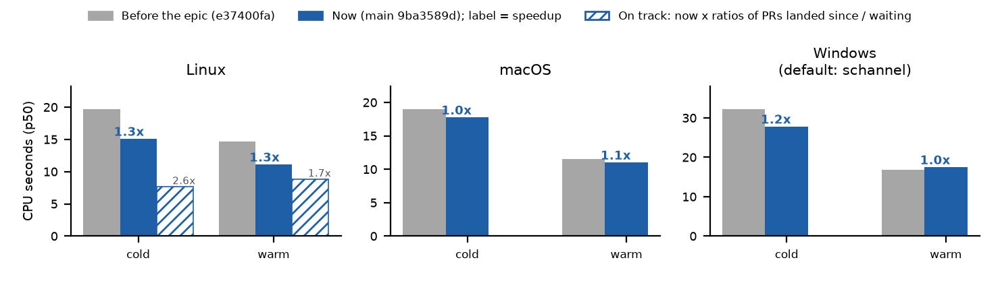
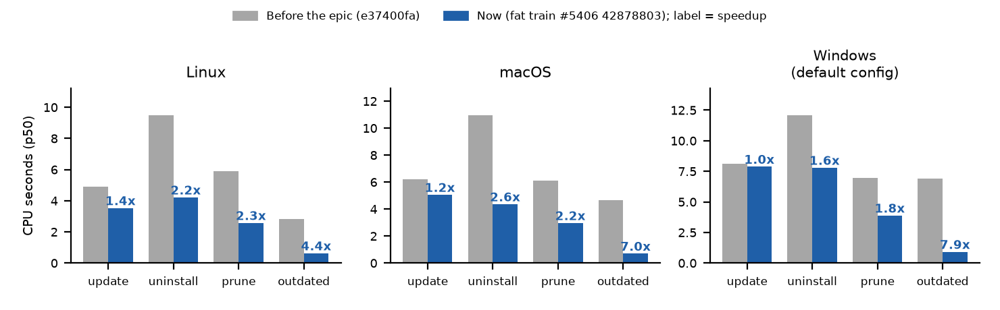
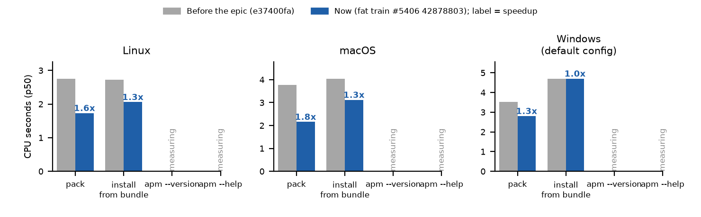

# APM performance since the epic

*PERF org report for the CEO, v2 2026-11-25 06:08 CET (data: Journey Hunt report.json; NEW = the fat train head). Final refresh after Wednesday's final bench pass.*

**Baseline (paired).** **Before the epic** = main `e37400fa` (v0.38.0) vs the fat train head (#5406) `42878803`: Journey Hunt bench (6 pairs per cell).

**Runner classes.** Ratios are the claim. Cold t50 cells on Linux and Windows drew no EPYC 9V74 runner (5 pairs each on EPYC 7763, 9V45 and Xeon 8573C), so their seconds are pooled medians across classes.

**How to read.** CPU seconds incl. child processes, p50 of interleaved before/now pairs on the same CI runner (3 runners per OS, modeled RTT 30 ms). **Speedup = 1 / paired p50 ratio; the ratio is the claim.** Seconds vary up to 2x by runner CPU class (reference AMD EPYC 9V74), so compare ratios. tree-10 / tree-50 = a project with 10 / 50 dependencies. Populations: *anonymous* = public github.com without a token; *authenticated* = token-first; *GHE* = enterprise host fixture; *all* = local commands with no network. Windows = default Git for Windows (schannel TLS) unless labelled OpenSSL.

**Headline (tree-50, vs e37400fa).** First install (cold, anonymous): Linux 2.67x, macOS 3.00x, Windows 2.89x. CI install (frozen): Linux 2.30x, macOS 2.71x, Windows 2.56x. Warm: Linux 1.90x, macOS 1.49x, Windows 1.23x. No-op installs, first re-install / repeat / --frozen no-op. First unchanged re-install (#2, footnote 1): Linux 6.62x, macOS 5.88x, Windows 6.55x; repeat no-op (#3+): Linux 27.30x, macOS 21.97x, Windows 22.97x; --frozen no-op: Linux 2.81x (tree-10) / 5.04x (tree-50); the first --frozen after an install misses the fast path (argv-keyed attestation: every sample traces 'attested miss: argv'), fix in v0.40. **Windows default config now engages the in-process fetch** (footnote 2; #5376, merged: default cold 0.449 / 0.447, warm 0.868 of the main before it), so Windows numbers above are the default setup. Other commands, ranges across OS and tree size: audit 1.4-3.1x; outdated 2.0-7.9x; uninstall 1.3-2.6x; prune 1.5-2.3x; compile 0.9-1.6x; pack 1.0-1.8x; boot 0.9-1.0x (flat).

*Footnote 1 (no-op rows): the bench's first unchanged re-install (#2) is the first unchanged install after a full install; every sample starts from a fresh APM home plus a full setup install. Main pays the no-op proof there; #5383 turns it into a record hit by attesting at the end of the full install. The repeat no-op (replay) is install #3+. Not a product bug (run 45523138212).*

*Footnote 2 (Windows default numbers): offline-mirror bench; real-network engagement confirmed (run 45518723251).*

## 1. Install journeys, anonymous public github.com (tree-50, vs e37400fa)

- **Fetch in process (B1).** [#5330](https://github.com/microsoft/apm/pull/5330) (merged) (Linux/macOS) and [#5351](https://github.com/microsoft/apm/pull/5351) (merged) (Windows) fetch the pinned commit over smart HTTP inside apm instead of a git CLI chain per package: cold t50 spawns ~670 -> ~18, requests 201 -> 101. [#5376](https://github.com/microsoft/apm/pull/5376) (merged) makes it engage under default Windows TLS (schannel -> OS trust store): Windows default cold 0.449 / 0.447, warm 0.868.
- **Ask git once, list once.** [#5341](https://github.com/microsoft/apm/pull/5341) (merged) + [#5283](https://github.com/microsoft/apm/pull/5283) (merged) read the effective git config once per command (262 probes -> 1); [#5318](https://github.com/microsoft/apm/pull/5318) (merged) verifies every pinned commit from one shared ref listing per remote.
- **Resolve paths fewer times.** [#5132](https://github.com/microsoft/apm/pull/5132) (merged) string containment; kernel realpath on Linux (#5333 via train [#5355](https://github.com/microsoft/apm/pull/5355) (merged)); [#5354](https://github.com/microsoft/apm/pull/5354) (merged) + [#5380](https://github.com/microsoft/apm/pull/5380) (merged) resolve each root once; [#5204](https://github.com/microsoft/apm/pull/5204) (merged) removed a per-package quadratic re-seal; [#5372](https://github.com/microsoft/apm/pull/5372) (merged) resolves link-free paths with one openat2 (Linux 0.906 / 0.919). Waiting: [#5374](https://github.com/microsoft/apm/pull/5374) (open) exact Windows paths (Windows 0.961 anon / 0.967 auth), [#5382](https://github.com/microsoft/apm/pull/5382) (open) containment once per directory (on the stack: macOS -15%, Linux -1-2%, Windows unchanged as it overlaps #5374).
- **Lockfile once; skip proven work.** [#5325](https://github.com/microsoft/apm/pull/5325) (merged) parse once, [#4888](https://github.com/microsoft/apm/pull/4888) (merged) reuse what the command wrote, [#5361](https://github.com/microsoft/apm/pull/5361) (merged) libyaml emit (0.86 -> 0.05 s); [#4893](https://github.com/microsoft/apm/pull/4893) (merged) locked engine + [#4846](https://github.com/microsoft/apm/pull/4846) (merged) deploy store let frozen installs skip the pipeline. **Repeat user:** [#4993](https://github.com/microsoft/apm/pull/4993) (merged) replays a verified no-op (re-install #3+: Linux 2.55 -> 0.30 s, Windows 4.42 -> 0.59 s, runs 45456265890/45456307290). **First re-install (#2), on track:** [#5383](https://github.com/microsoft/apm/pull/5383) (open) records at install so #2 also skips the proof: Linux 3.41 -> 1.73 s (0.515), macOS 3.10 -> 1.40 s (0.504), Windows 5.53 -> 2.34 s (0.431).

## 2. Authenticated and enterprise installs (tree-50, vs e37400fa)

- **In the measured head:** [#5353](https://github.com/microsoft/apm/pull/5353) (merged) authenticated in-process fetch + shared listing. Validated on main 0a2460a7 (t50, 6 pairs; runs 45475047324 / 45475248050): authenticated cold Linux 12.68 -> 8.52 s (0.530), Windows (OpenSSL backend) 28.45 -> 17.68 s (0.456); spawns ~364 -> 20, requests 250 -> 100; authenticated warm Linux 0.796, Windows 0.866 with ls-remote 50 -> 0. **Authenticated cold now costs the same as anonymous.** [#5366](https://github.com/microsoft/apm/pull/5366) (merged) writes and verifies git-path checkouts from the pack in process: enterprise (GHE) Windows 0.845 / 0.848.
- **Enterprise (GHE fixture), vs e37400fa:** cold t50 Linux 1.49x, macOS 1.33x -- B1 does not apply yet. A/A [45466484736]: Linux t50 GHE 14.94 s vs github.com 8.19 s, ~45% headroom: B1 on enterprise hosts is security-cleared and the next lever. [#5377](https://github.com/microsoft/apm/pull/5377) (open) (lever S) fetches monorepo subdirectory deps as pin trees + exact blobs (real monorepo Linux 0.502, macOS 0.478).

## 3. Lifecycle: update, uninstall, prune, outdated (tree-50, vs e37400fa)

- **outdated:** [#4960](https://github.com/microsoft/apm/pull/4960) (merged) lists public github.com refs in process (at merge: wall t50 2.35-2.4x; round trips 200 -> 58, spawns 252 -> 2).
- **update** (resolve newest refs, then the install pipeline): Linux 1.36x, macOS 1.18x (6 pairs; the 95% band crosses 1.0, so flat, not a regression), **Windows 1.03x**. Before #5376 Windows default update was a regression (0.76x): under schannel the ref listing fell back to git ls-remote + a POST per dep (spawns 73 -> 168); #5376 (merged) moves it back in process.
- **uninstall / prune:** [#4888](https://github.com/microsoft/apm/pull/4888) (merged) reads the lockfile the command just wrote instead of re-parsing it (prune t50 Linux 7.15 -> 5.90 s at merge); the lockfile ([#5325](https://github.com/microsoft/apm/pull/5325) (merged), [#5361](https://github.com/microsoft/apm/pull/5361) (merged)) and path ([#5354](https://github.com/microsoft/apm/pull/5354) (merged)) levers apply to every command that loads the lockfile.

## 4. Compile and audit (tree-50, vs e37400fa)

- **audit:** [#5018](https://github.com/microsoft/apm/pull/5018) (merged) serves drift replay from verified render records instead of re-rendering every package (at merge, 15 pairs: Linux 9.31 -> 5.22 s, -43.9%; macOS -43.0%; Windows -37.6%).
- **audit --ci, compile:** no dedicated lever this epic; they gain only from the shared lockfile, YAML and path levers.

## 5. Pack, bundle install and boot (tree-50, vs e37400fa)

- **pack / install from bundle:** no dedicated lever; shared lockfile and path levers only.
- **boot (`--version`, `--help`):** every boot lever was measured and killed: entry fast path #4802 (modules 373 -> 77 gave 1.00x; reverted by #4855), lazy imports (Linux 0.988, Windows 0.995), frozen/zipapp boot (no win). Boot is ~0.45 s of a Linux install and stays flat.

## 6. Speedup per command, OS and population

Speedup = 1 / paired p50, tree-50 / tree-10, vs e37400fa (before the epic). *p* = provisional v1-harness row; *i* = interim vs 703acd6f (15 pairs, Windows OpenSSL backend); *measuring* = no data yet.

| command | population | Linux t50 / t10 | macOS t50 / t10 | Windows t50 / t10 |
|---|---|---|---|---|
| install cold | anonymous | 2.67x / 2.07x | 3.00x / 2.08x | 2.89x / 2.27x |
| install frozen | anonymous | 2.30x / 1.81x | 2.71x / 2.03x | 2.56x / 2.14x |
| install warm | anonymous | 1.90x / 1.62x | 1.49x / 1.36x | 1.23x / 1.20x |
| re-install #2 (unchanged) | all | 6.62x / 3.06x | 5.88x / 2.92x | 6.55x / 3.10x |
| re-install #3+ (repeat user) | all | 27.30x / 11.24x | 21.97x / 9.14x | 22.97x / 9.75x |
| --frozen no-op (CI re-run) | all | 5.04x / 2.81x | measuring | measuring |
| install cold | authenticated | 2.71x / 1.83x | 3.12x / 2.25x | 2.91x / 2.19x |
| install warm | authenticated | 1.89x / 1.67x | 1.66x / 1.34x | 1.34x / 1.23x |
| install cold | GHE anonymous | 1.49x / 1.27x | 1.33x / 1.18x | 1.42x / 1.24x |
| install warm | GHE anonymous | 1.46x / 1.38x | 1.36x / 1.18x | 1.10x / 1.03x |
| re-install #2 (unchanged) | GHE anonymous | 6.92x / 3.22x | 6.53x / 2.59x | 5.96x / 2.85x |
| install cold | GHE authenticated | 1.47x / 1.39x | 1.31x / 1.23x | 1.44x / 1.36x |
| update | anonymous | 1.36x / 1.22x | 1.18x / 0.88x | 1.03x / 1.08x |
| uninstall | anonymous | 2.25x / 1.68x | 2.55x / 1.32x | 1.57x / 1.42x |
| prune | anonymous | 2.29x / 1.63x | 2.20x / 1.51x | 1.77x / 1.49x |
| outdated | anonymous | 4.43x / 2.03x | 6.98x / 2.01x | 7.87x / 2.65x |
| compile | all | 1.57x / 1.24x | 1.44x / 0.91x | 1.36x / 1.12x |
| audit | all | 3.06x / 2.12x | 2.31x / 1.41x | 1.97x / 1.56x |
| audit --ci | all | 2.84x / 2.04x | 2.70x / 1.39x | 1.87x / 1.49x |
| pack | all | 1.58x / 1.27x | 1.78x / 1.04x | 1.27x / 1.11x |
| install from bundle | all | 1.32x / 1.14x | 1.30x / 0.88x | 1.00x / 0.97x |
| apm --version | all | - / 0.98x | - / 0.95x | - / 1.00x |
| apm --help | all | - / 0.98x | - / 0.83x | - / 0.92x |

Rows below 1.00x: apm --version Linux tree-10, apm --help macOS tree-10, apm --version macOS tree-10, compile macOS tree-10, install from bundle macOS tree-10, update macOS tree-10, apm --help Windows tree-10, install from bundle Windows tree-10 have 95% bands that include 1.0 (noise, not regressions); apm --help Linux tree-10 is +2% with its band above 1.0 (120 -> 123 ms).

## 7. Gap to floor, what did not work, what is next

Cold install t50 is now 5.2 s on Linux and 11.6 s on Windows default config (seconds depend on runner class), about 7x and 8x the physics floor (~0.7 s Linux, ~1.5 s Windows: 0 git children, 2 requests per package). Bytes are already at the floor; validated paired-deletion ceilings (t50 anonymous, EPYC 9V74, runs 45464564203, 45464596572, 45464623708, 45464660115, 45464777276, 45464818672) put **integrate incl. discovery at 60%** of install (Linux 3.5 s / Windows 6.7 s), **lockfile build+write, ledger and journal at 27%**, policy + audit + content scan at 3%, and resolve + fetch + boot + glue at 10% or less. **What did not work:** lazy imports, frozen/zipapp boot, single-pass integrate (bytes are only ~6%; the cost is per-file Python and path containment), stat cuts, the rest-bucket cut, #5352 (~1.00 on GHE/GitLab) and small cars that stayed within noise; all were measured and killed. Honest caveat: on the current stack, locked-warm costs 1.21-1.29x warm (A/A 45464702877), attribution in progress. **Next:** land the waiting PRs (#5374 Windows paths, #5382 containment once, #5383 re-install #2); then a 5x on Linux needs an integrate redesign plus the lockfile cut, with B1 on enterprise hosts and lever S (#5377) for monorepos.
